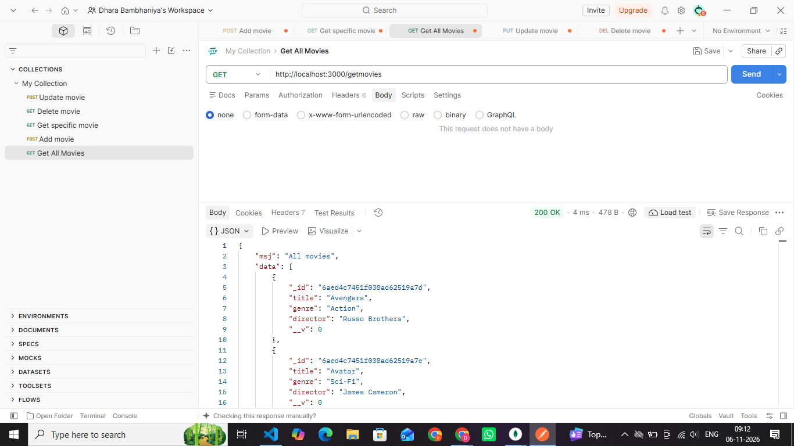
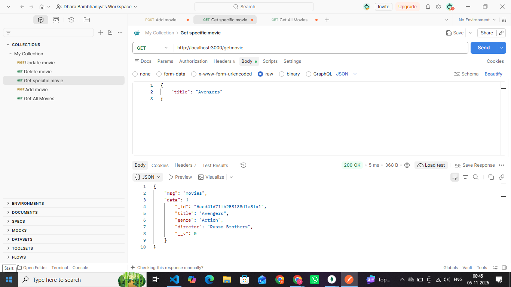
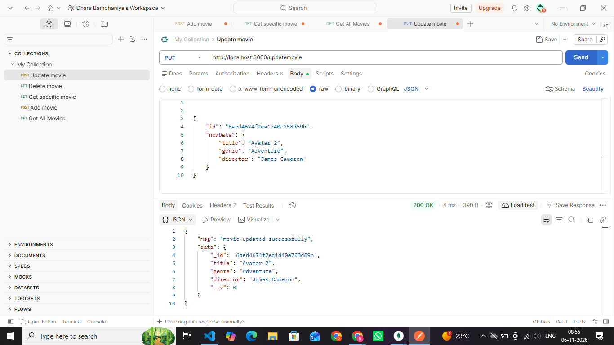
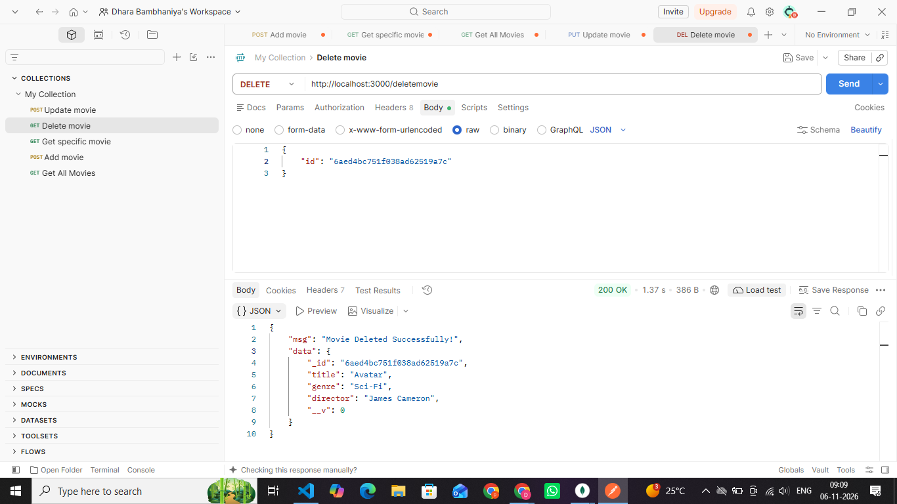

# 🎬 Movie Management API

A simple **Movie Management API** built using Node.js, Express.js, and MongoDB with Mongoose.

This project performs basic CRUD operations such as adding, viewing, searching, updating, and deleting movies.

## 🚀 Technologies Used

- Node.js
- Express.js
- MongoDB
- Mongoose

## 📌 API Features

### 1. Add Movie

**Method:** POST

**Endpoint:** `/addmovie`

Add a new movie to the database.


### 2. Get All Movies

**Method:** GET

**Endpoint:** `/getmovies`

Get all movies stored in the database.



### 3. Get Specific Movie

**Method:** GET

**Endpoint:** `/getmovie`

Find a specific movie using its details.



### 4. Update Movie

**Method:** PUT

**Endpoint:** `/updatemovie`

Update an existing movie using its MongoDB ID.



### 5. Delete Movie

**Method:** DELETE

**Endpoint:** `/deletemovie`

Delete a movie using its MongoDB ID.



## ⚙️ Installation & Setup

1. Clone the repository.

2. Install dependencies:

   ```bash
   npm install
   ```

3. Start MongoDB on your system.

4. Run the project:

   ```bash
   node app.js
   ```

5. Server will run at :

   `http://localhost:3000`

## 🎥 Project Demo Video

[Click Here to Watch Project Demo](https://drive.google.com/file/d/1Gu1uifigWOZBzRiiuQE19goTGqh574s9/view?usp=sharing)

## 👩‍💻 Author

**Dhara Bambhaniya**

Frontend / Backend Development Learner
